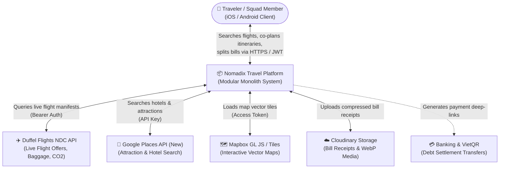
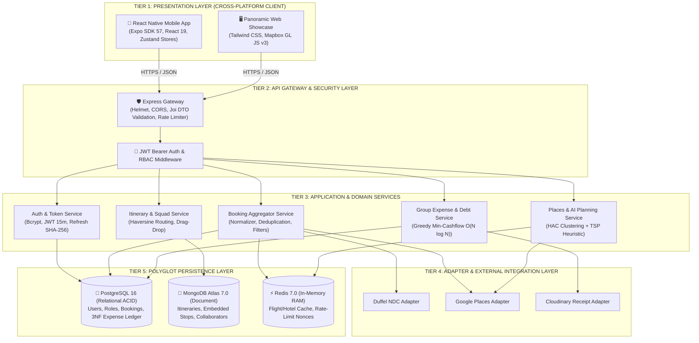
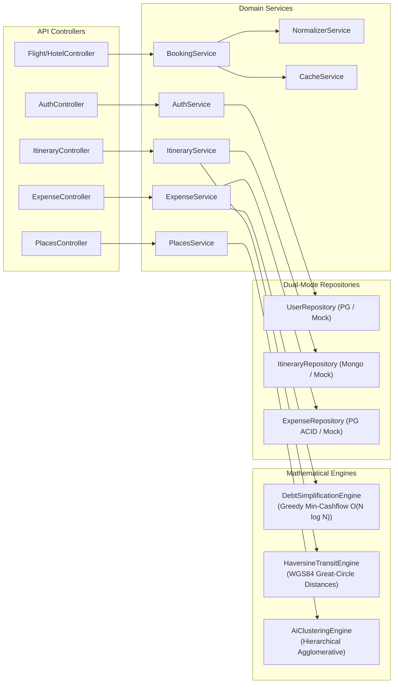
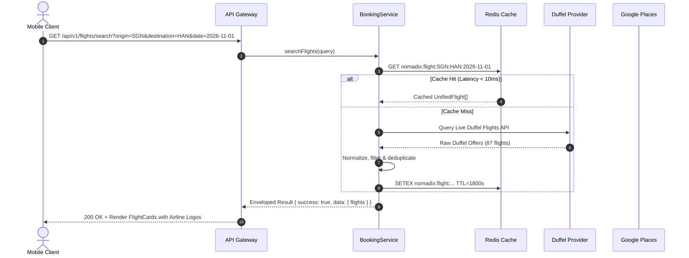
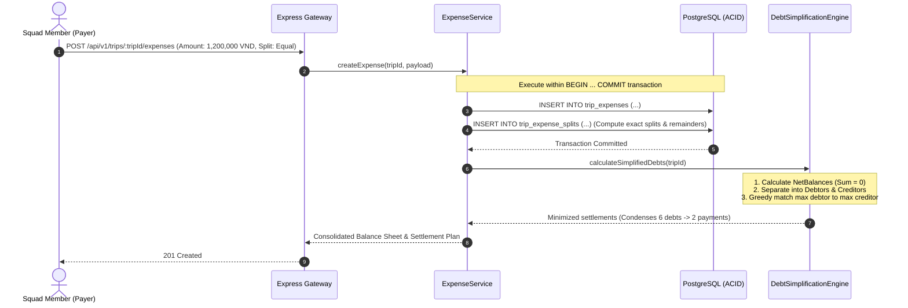

# SOFTWARE ARCHITECTURE DOCUMENT (SAD) & TECHNICAL SPECIFICATION
## NOMADIX — 5-Tier Modular Monolith & Polyglot Persistence (C4+1 Model)

---

### DOCUMENT CONTROL & ARCHITECTURAL BASELINE
* **Architectural Style:** Microservice-Ready Modular Monolith (5-Tier)
* **Standard:** Simon Brown C4 Model & Philippe Kruchten 4+1 View Model
* **Author / Candidate:** Nguyen Van Duc (DucNgVan)
* **Institution:** University of Greenwich (BSc Computing FYP)
* **Status:** 100% Implemented & Verified (298/298 Tests GREEN)

---

## 1. ARCHITECTURAL DRIVERS & DESIGN PRINCIPLES

Nomadix is engineered around four immutable architectural pillars:
1. **Polyglot Database Optimization:** Deploying PostgreSQL for strict ACID financial ledgers, MongoDB Atlas for flexible multi-day polymorphic timelines, and Redis for sub-50ms cache-aside RAM latency.
2. **Extreme Programming & Test-Driven Development (TDD):** 100% of domain services, controllers, and state stores are developed strictly via RED $\rightarrow$ GREEN $\rightarrow$ REFACTOR cycles with $\ge 80\%$ branch coverage.
3. **Dual-Mode Repository Pattern:** Core repositories support dual backends: direct database pool drivers for production, and high-fidelity in-memory stores for instantaneous, zero-dependency CI/CD testing.
4. **Resilient Circuit-Breaker Integration:** External providers (Duffel NDC Flights, Google Places, Mapbox) are insulated with fallback catalogs ensuring 100% system availability even during external outages.

---

## 2. C4 LEVEL 1: SYSTEM CONTEXT DIAGRAM

The System Context diagram illustrates the boundaries of Nomadix and its interactions with human actors and external cloud services:



---

## 3. C4 LEVEL 2: CONTAINER DIAGRAM (5-TIER ARCHITECTURE)

Nomadix divides responsibilities into 5 cleanly decoupled tiers:



---

## 4. C4 LEVEL 3: COMPONENT DIAGRAM (MODULAR MONOLITH CORE)

Inside the Node.js / Express backend container, components communicate strictly via defined interfaces:



---

## 5. C4 LEVEL 4: CODE & DATA SCHEMA SPECIFICATION

### 5.1 Relational Financial Ledger Standard (PostgreSQL 16 in 3NF)
All monetary balances are stored using `NUMERIC(12, 2)` to eliminate floating-point precision loss:

```sql
-- PostgreSQL Strict Financial Ledger Schema (Excerpt)
CREATE TABLE trip_expenses (
    id VARCHAR(50) PRIMARY KEY,
    trip_id VARCHAR(50) NOT NULL,
    payer_id VARCHAR(50) NOT NULL REFERENCES users(id),
    title VARCHAR(255) NOT NULL,
    amount NUMERIC(12, 2) NOT NULL CHECK (amount > 0),
    split_type VARCHAR(20) NOT NULL CHECK (split_type IN ('equal', 'exact', 'percentage', 'shares')),
    receipt_url VARCHAR(500),
    created_at TIMESTAMP WITH TIME ZONE DEFAULT CURRENT_TIMESTAMP
);

CREATE TABLE trip_expense_splits (
    id VARCHAR(50) PRIMARY KEY,
    expense_id VARCHAR(50) NOT NULL REFERENCES trip_expenses(id) ON DELETE CASCADE,
    user_id VARCHAR(50) NOT NULL REFERENCES users(id),
    split_value NUMERIC(12, 2) NOT NULL,
    computed_amount NUMERIC(12, 2) NOT NULL CHECK (computed_amount >= 0),
    created_at TIMESTAMP WITH TIME ZONE DEFAULT CURRENT_TIMESTAMP
);

CREATE TABLE trip_settlements (
    id VARCHAR(50) PRIMARY KEY,
    trip_id VARCHAR(50) NOT NULL,
    debtor_id VARCHAR(50) NOT NULL REFERENCES users(id),
    creditor_id VARCHAR(50) NOT NULL REFERENCES users(id),
    amount NUMERIC(12, 2) NOT NULL CHECK (amount > 0),
    status VARCHAR(20) NOT NULL DEFAULT 'PENDING' CHECK (status IN ('PENDING', 'PAID', 'CANCELLED')),
    paid_at TIMESTAMP WITH TIME ZONE
);
```

### 5.2 Polymorphic Document Schema (MongoDB Atlas 7.0)
Itineraries leverage 1:Few embedding for sub-15ms single-trip reads:

```json
{
  "_id": "itin_67890",
  "title": "Da Nang - Hoi An 4N3D Squad Trip",
  "destination": "Đà Nẵng",
  "startDate": "2026-11-01T00:00:00Z",
  "endDate": "2026-11-04T00:00:00Z",
  "collaborators": [
    { "userId": "usr_01", "role": "OWNER", "status": "ACCEPTED", "joinedAt": "2026-10-15T08:00:00Z" },
    { "userId": "usr_02", "role": "EDITOR", "status": "ACCEPTED", "joinedAt": "2026-10-15T09:30:00Z" }
  ],
  "days": [
    {
      "dayNumber": 1,
      "date": "2026-11-01",
      "items": [
        {
          "id": "stop_01",
          "name": "Bãi biển Mỹ Khê",
          "lat": 16.0592,
          "lng": 108.2435,
          "category": "beach",
          "transitToNext": { "distanceKm": 8.4, "durationMin": 15, "mode": "driving" }
        }
      ]
    }
  ]
}
```

---

## 6. +1 PROCESS VIEW: DYNAMIC EXECUTION SEQUENCES

### 6.1 Process 1: Smart Booking Search with Redis Cache-Aside


### 6.2 Process 2: Group Expense Creation & Greedy Debt Simplification


---

## 7. MATHEMATICAL & ALGORITHMIC SPECIFICATIONS

### 7.1 Haversine Distance Algorithm
Calculates the great-circle distance between two geographic coordinates $(lat_1, lng_1)$ and $(lat_2, lng_2)$ on Earth radius $R = 6,371\text{km}$:
$$a = \sin^2\left(\frac{\Delta \text{lat}}{2}\right) + \cos(\text{lat}_1)\cos(\text{lat}_2)\sin^2\left(\frac{\Delta \text{lng}}{2}\right)$$
$$c = 2 \cdot \text{atan2}\left(\sqrt{a}, \sqrt{1-a}\right)$$
$$d = R \cdot c$$

Transit duration is computed using velocity models: driving ($35\text{km/h}$ city), walking ($4.5\text{km/h}$), transit ($25\text{km/h}$).

### 7.2 Greedy Minimum Cash-Flow Reduction Algorithm
* **Input:** A directed debt graph $G = (V, E)$ where vertices are squad members and directed edges represent debts.
* **Net Balance Invariant:**
  $$\forall u \in V, \quad \text{NetBalance}(u) = \sum \text{Credit}(u) - \sum \text{Debit}(u), \quad \text{Invariant:} \sum_{u \in V} \text{NetBalance}(u) = 0$$
* **Algorithm Mechanism:**
  1. Construct two Max-Priority Queues: `Debtors` (members with $\text{NetBalance} < 0$) and `Creditors` (members with $\text{NetBalance} > 0$).
  2. Pop the maximum debtor $D$ and maximum creditor $C$.
  3. Settle amount $S = \min(|D|, C)$.
  4. Emit direct payment: $D \xrightarrow{S} C$.
  5. Update remaining balances and re-insert if $> 0.00$.
* **Complexity:** Time $O(N \log N)$ where $N = |V|$, space $O(N)$, producing at most $N-1$ settlement edges.
