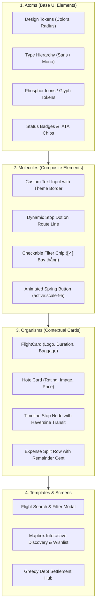

# UX/UI DESIGN SYSTEM & MOBILE ERGONOMICS SPECIFICATION
## NOMADIX — Modern Travel Platform Design Tokens & Interaction Guidelines

---

### DOCUMENT CONTROL & COMPLIANCE
* **Standard:** ISO 9241-210 (Human-Centered Design) & WCAG 2.1 Level AA
* **Target Platforms:** iOS 17+, Android 14+ (Cross-Platform React Native & Web)
* **Author / Candidate:** Nguyen Van Duc (DucNgVan)
* **Institution:** University of Greenwich (BSc Computing FYP)
* **Status:** Baseline Design Tokens for Core MVP Showcase

---

## 1. DESIGN PHILOSOPHY & BRAND IDENTITY

Nomadix's design language is built on four core visual and experiential principles:
1. **Calm Clarity (Trực quan & Tinh gọn):** Travel planning is cognitively demanding. The interface eliminates visual noise, presenting information in hierarchical digestible cards with generous breathing room.
2. **Dual-Theme Parity (Đồng bộ Giao diện Sáng / Tối):** Full dynamic switching between Light Mode (fresh, airy pale sky blue `#F0F6FF`) and Dark Mode (immersive deep navy `#0D1B2A`), ensuring zero high-contrast glare or white-box visual defects.
3. **Ergonomic Thumb-Zone Architecture (Công thái học di động):** Critical actions, bottom tab navigation, search triggers, and modal dismissals are anchored in the lower 40% of the mobile viewport for effortless one-handed operation.
4. **Radical Financial Transparency (Minh bạch tài chính tuyệt đối):** Color-coded transaction flows (Emerald green for credits/positive balances, Rose red for debts/overdue payments, Amber for transit and warnings) to eliminate ambiguity during squad bill splits.

---

## 2. COLOR PALETTE SPECIFICATION (DESIGN TOKENS)

Nomadix utilizes a strictly tokenized color system designed to pass WCAG 2.1 Level AA contrast ratio checks ($\ge 4.5:1$ for normal body text, $\ge 3:1$ for large headings and interactive components):

```
┌────────────────────────────────────────────────────────────────────────────────────────┐
│                              NOMADIX COLOR TOKEN MATRIX                                │
├───────────────────────┬───────────┬───────────┬────────────────────────────────────────┤
│ Token Name            │ Light Hex │ Dark Hex  │ Usage & Semantic Role                  │
├───────────────────────┼───────────┼───────────┼────────────────────────────────────────┤
│ `color.brand.primary` │ `#007AFF` │ `#2563EB` │ Primary CTA buttons, active tab glyphs │
│ `color.brand.accent`  │ `#06B6D4` │ `#22D3EE` │ AI itinerary clustering badge, chips   │
│ `color.bg.root`       │ `#F0F6FF` │ `#0D1B2A` │ Global screen background surface       │
│ `color.bg.card`       │ `#FFFFFF` │ `#1E293B` │ Elevated surface, ticket cards, modals │
│ `color.text.primary`  │ `#0F172A` │ `#FFFFFF` │ Main headings, flight times, titles    │
│ `color.text.muted`    │ `#64748B` │ `#94A3B8` │ Subtitles, airport labels, captions    │
│ `color.border`        │ `#DCE8F6` │ `#334155` │ Card borders, input field outlines     │
│ `color.semantic.green`│ `#10B981` │ `#34D399` │ Settled payments, creditor balances    │
│ `color.semantic.rose` │ `#EF4444` │ `#F87171` │ Debtor balances, overdue alerts, stops │
│ `color.semantic.amber`│ `#F59E0B` │ `#FBBF24` │ Connecting flight stops, baggage warn  │
└───────────────────────┴───────────┴───────────┴────────────────────────────────────────┘
```

### 2.1 WCAG 2.1 Level AA Contrast Verification
* **Light Mode:** `#0F172A` on `#FFFFFF` yields **15.4:1** (Passes AAA).
* **Light Mode Muted:** `#64748B` on `#FFFFFF` yields **4.6:1** (Passes AA).
* **Dark Mode:** `#FFFFFF` on `#1E293B` yields **13.8:1** (Passes AAA).
* **Brand Button:** `#FFFFFF` text on `#007AFF` yields **4.52:1** (Passes AA).

---

## 3. TYPOGRAPHY SYSTEM & HIERARCHY

Nomadix adopts **Plus Jakarta Sans** as its primary sans-serif display and body typeface, paired with **JetBrains Mono** for numerical precision, flight numbers, currency, and airport codes.

```
┌────────────────────────────────────────────────────────────────────────────────────────┐
│                              TYPOGRAPHY SCALE HIERARCHY                                │
├───────────────┬────────────┬─────────────┬────────────┬────────────────────────────────┤
│ Type Scale    │ Font Size  │ Line Height │ Weight     │ Application Context            │
├───────────────┼────────────┼─────────────┼────────────┼────────────────────────────────┤
│ `Display`     │ 28px - 32px│ 36px - 40px │ 800 (Bold) │ Top-level hero titles, prices  │
│ `Title-1`     │ 20px - 22px│ 26px - 28px │ 700 (Bold) │ Screen headers, modal titles   │
│ `Title-2`     │ 16px - 18px│ 22px - 24px │ 600 (Semi) │ Card titles, airline names     │
│ `Body-Large`  │ 14px - 15px│ 20px - 22px │ 500 (Med)  │ Flight times, stop names, inputs│
│ `Body-Small`  │ 12px - 13px│ 16px - 18px │ 400 (Reg)  │ Descriptions, transit notes    │
│ `Caption`     │ 10px - 11px│ 14px - 16px │ 700 (Bold) │ Airport IATA tags, badges, chips│
│ `Mono-Number` │ 13px - 16px│ 18px - 22px │ 600 (Mono) │ Currency amounts, baggage count│
└───────────────┴────────────┴─────────────┴────────────┴────────────────────────────────┘
```

---

## 4. SPATIAL SYSTEM, CORNER RADIUS & ELEVATION

### 4.1 4px / 8px Rhythmic Spacing Grid
All paddings, margins, and component dimensions are multiples of 4px:
* `space-1` (4px): Inner badge padding, icon-text gap.
* `space-2` (8px): Chip padding, list item horizontal margins.
* `space-3` (12px): Search card inner row spacing, input padding.
* `space-4` (16px): Screen edge gutter, modal card padding.
* `space-6` (24px): Section separation, between-card margins.

### 4.2 Corner Radius Tokens
* `rounded-lg` (8px): Small badges, airport IATA code pills.
* `rounded-xl` (12px): Form inputs, filter chips, secondary buttons.
* `rounded-2xl` (16px): Main flight cards, hotel cards, bottom sheet modals.
* `rounded-3xl` (24px): Screen container cards, root modal sheets.
* `rounded-full` (9999px): Avatar pills, action FAB buttons.

### 4.3 Elevation & Shadow Tokens
* **iOS Soft Elevation:** `0 2px 10px rgba(0, 0, 0, 0.04)` (Clean card separation in Light Mode).
* **Phone Bezel Shadow:** `0 25px 80px -15px rgba(0, 0, 0, 0.35)` (Realistic iPhone 16 Pro mockup depth).
* **Modal Bottom Sheet Shadow:** `0 -10px 40px rgba(0, 0, 0, 0.3)` (Focused modal backdrop).

---

## 5. ATOMIC COMPONENT SPECIFICATIONS



---

## 6. MOBILE ERGONOMICS & THUMB-ZONE MAPPING

```
┌───────────────────────────────────────┐
│        IPHONE 16 PRO VIEWPORT         │
│  [Dynamic Island / Status Bar: 48px]  │
├───────────────────────────────────────┤
│                                       │
│          HARD TO REACH ZONE           │
│        (Top 25% of viewport)          │
│   • Back navigation arrow             │
│   • Screen title, decorative banners  │
│                                       │
├───────────────────────────────────────┤
│                                       │
│          NATURAL STRETCH ZONE         │
│        (Middle 35% of viewport)       │
│   • Scrollable flight card list       │
│   • Mapbox vector map interaction     │
│   • Timeline daily stop cards         │
│                                       │
├───────────────────────────────────────┤
│                                       │
│           EASY THUMB ZONE             │
│        (Bottom 40% of viewport)       │
│   ★ Search filter triggers            │
│   ★ "+ Tạo kế hoạch", "Thanh toán"    │
│   ★ "✨ AI Lên Lịch Trình" FAB button │
│   ★ 4-Tab Bottom Navigation Bar       │
│                                       │
└───────────────────────────────────────┘
```

* **Touch Target Standard:** All interactive touch elements maintain a minimum hit area of **$44 \times 44\text{pt}$** ($48 \times 48\text{dp}$ on Android).
* **Micro-interactions:** Interactive touch targets include an instantaneous $150\text{ms}$ active spring scale reduction (`transform: scale(0.96)`) to provide tactile haptic feedback without native vibration lag.

---

## 7. NIELSEN NORMAN 10 HEURISTICS COMPLIANCE IN NOMADIX

1. **Visibility of System Status:** Live flight search loading skeletons, active tab indicators, and progress pills show exact system status.
2. **Match Between System and Real World:** Airport IATA codes resolve automatically to Vietnamese city names (`Hà Nội` $\rightarrow$ `HAN`, `Sài Gòn` $\rightarrow$ `SGN`).
3. **User Control and Freedom:** Collapsible search bar with "Thay đổi" button allows one-tap modification of dates and routes.
4. **Consistency and Standards:** Strict adherence to iOS Human Interface Guidelines and Google Material Design 3.
5. **Error Prevention:** Past dates in calendar pickers are physically disabled (`minDate = today`); identical origin and destination airports are prohibited.
6. **Recognition Rather Than Recall:** Baggage policy is displayed with human icons (`🧳 1 kiện ký gửi • 1 kiện xách tay`) instead of complex airline tariff codes.
7. **Flexibility and Efficiency of Use:** 1-tap quick destination chips (`Đà Nẵng`, `Hà Nội`, `Tokyo 🇯🇵`) for rapid search.
8. **Aesthetic and Minimalist Design:** High visual hierarchy; secondary technical metadata (emissions, aircraft) is presented in subdued contrast.
9. **Help Users Recognize and Recover from Errors:** Inline input error banners specify exact corrections needed (`"Ngày về không thể trước ngày đi"`).
10. **Help and Documentation:** Boarding passes display visual barcodes, gate info, and passenger names for quick reference at airport checkpoints.
