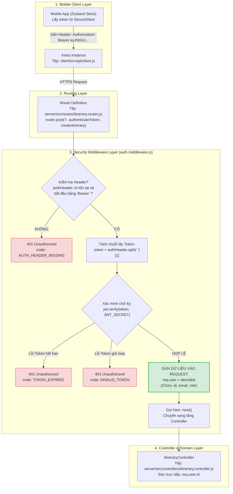
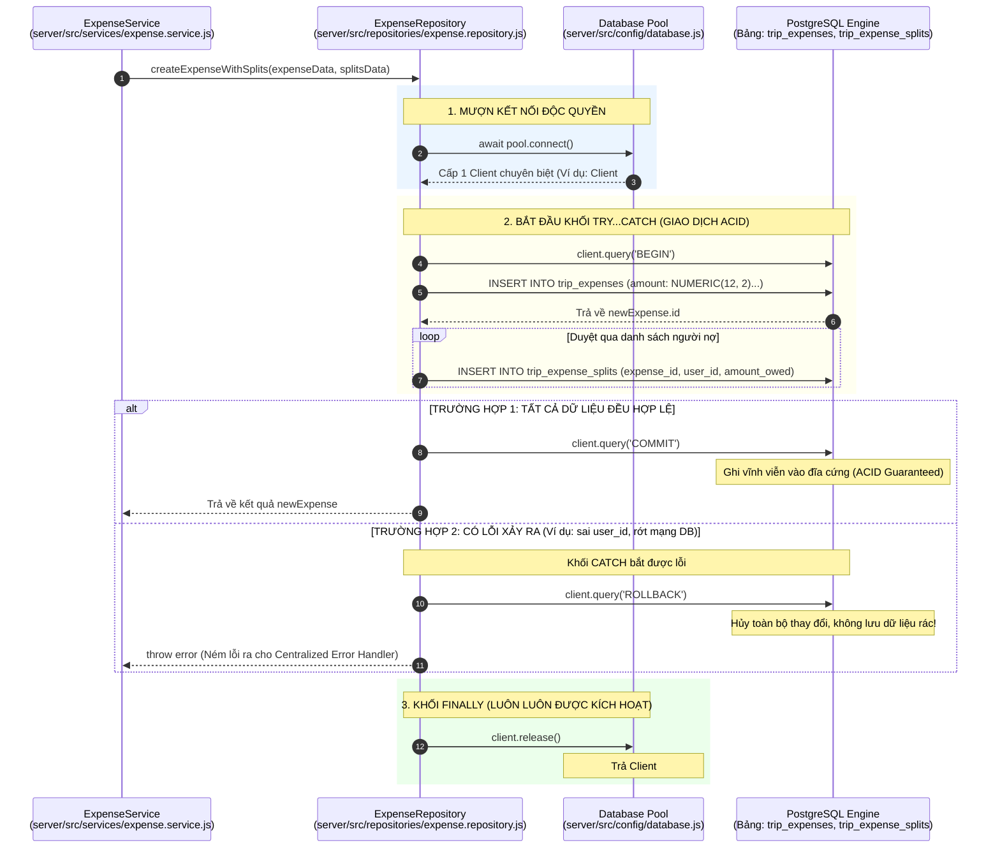

# Chuyên đề 01: Bảo mật Middleware & Giao dịch Cơ sở Dữ liệu ACID
## Deep-Dive: Authentication Pipeline & Multi-Table Transaction Management

> *"Mã nguồn chất lượng cao không chỉ dừng lại ở việc chạy đúng trong điều kiện lý tưởng (Happy Path), mà được định nghĩa bởi cách nó phòng vệ trước các cuộc tấn công bảo mật và khả năng phục hồi dữ liệu khi xảy ra sự cố đột ngột."*

---

## Mục lục
1. [Tổng quan Kiến trúc Tầng Code](#1-tổng-quan-kiến-trúc-tầng-code)
2. [Phần 1: Middleware Xác thực JWT (`auth.middleware.js`)](#2-phần-1-middleware-xác-thực-jwt-authmiddlewarejs)
   - [2.1 Sơ đồ Luồng Tín hiệu (Flowchart)](#21-sơ-đồ-luồng-tín-hiệu-flowchart)
   - [2.2 Mã nguồn Triển khai Thực tế](#22-mã-nguồn-triển-khai-thực-tế)
   - [2.3 Các Kịch bản Lỗi Thường gặp](#23-các-kịch-bản-lỗi-thường-gặp)
3. [Phần 2: Giao dịch ACID & Quản trị Connection Pool (`expense.repository.js`)](#3-phần-2-giao-dịch-acid--quản-trị-connection-pool-expenserepositoryjs)
   - [3.1 Sơ đồ Tuần tự Giao dịch (Sequence Diagram)](#31-sơ-đồ-tuần-tự-giao-dịch-sequence-diagram)
   - [3.2 Mã nguồn Triển khai Thực tế](#32-mã-nguồn-triển-khai-thực-tế)
   - [3.3 Tầm quan trọng Sống còn của `client.release()` trong `finally`](#33-tầm-quan-trọng-sống-còn-của-clientrelease-trong-finally)
4. [Bảng Tra cứu Vị trí Tệp Nhanh (File Map)](#4-bảng-tra-cứu-vị-trí-tệp-nhanh-file-map)
5. [Bộ Câu hỏi Vấn đáp Vòng Bảo vệ Đồ án (Defense Q&A)](#5-bộ-câu-hỏi-vấn-đáp-vòng-bảo-vệ-đồ-án-defense-qa)

---

## 1. Tổng quan Kiến trúc Tầng Code

Trong ứng dụng du lịch **Nomadix**, hai mắt xích cốt lõi quyết định độ tin cậy của toàn bộ hệ thống backend là:
1. **Lớp cổng bảo vệ (Security Gateway):** Nơi chặn đứng các request không hợp lệ trước khi chúng chạm vào Controller.
2. **Lớp dữ liệu tài chính (Financial Ledger):** Nơi ghi nhận hàng triệu đồng tiền chia nhóm mà không bao giờ được phép sai lệch một cent hay để lại dữ liệu rác mồ côi.

---

## 2. Phần 1: Middleware Xác thực JWT (`auth.middleware.js`)

### 2.1 Sơ đồ Luồng Tín hiệu (Flowchart)

Sơ đồ dưới đây minh họa cách một request di chuyển từ ứng dụng di động qua Router, được kiểm tra nghiêm ngặt qua 3 chốt chặn bảo mật của Middleware, giải mã dữ liệu và gắn thông tin vào đối tượng `req.user`.



### 2.2 Mã nguồn Triển khai Thực tế

Vị trí tệp: `server/src/middlewares/auth.middleware.js`

```javascript
const jwt = require('jsonwebtoken');

/**
 * Middleware xác thực Bearer JWT Token
 * Kiểm tra tính hợp lệ của Token trước khi cho phép đi tiếp vào Controller.
 */
const authenticateToken = (req, res, next) => {
  // 1. Trích xuất Header Authorization từ request
  const authHeader = req.headers['authorization'] || req.headers['Authorization'];

  // Nếu không có header hoặc định dạng không đúng chuẩn Bearer
  if (!authHeader || !authHeader.startsWith('Bearer ')) {
    return res.status(401).json({
      success: false,
      message: 'Access Denied: Missing or malformed Authorization header.',
      code: 'AUTH_HEADER_MISSING'
    });
  }

  // 2. Tách chuỗi lấy JWT nguyên bản (bỏ tiền tố 'Bearer ')
  const token = authHeader.split(' ')[1];

  // 3. Xác minh chữ ký số với bí mật JWT_SECRET
  try {
    const decoded = jwt.verify(token, process.env.JWT_SECRET);

    // Gán dữ liệu định danh người dùng vào req.user
    // Controller phía sau chỉ việc gọi req.user.id mà không cần query lại database
    req.user = decoded;

    // Cho phép chuyển tiếp sang Controller
    return next();
  } catch (error) {
    // 4. Phân loại mã lỗi chi tiết trong khối catch
    if (error.name === 'TokenExpiredError') {
      return res.status(401).json({
        success: false,
        message: 'Access Token has expired. Please refresh your session.',
        code: 'TOKEN_EXPIRED'
      });
    }

    // Token bị giả mạo hoặc chữ ký không khớp bí mật
    return res.status(401).json({
      success: false,
      message: 'Invalid signature or corrupted token.',
      code: 'INVALID_TOKEN'
    });
  }
};

module.exports = authenticateToken;
```

### 2.3 Các Kịch bản Lỗi Thường gặp
1. **Lỗi `AUTH_HEADER_MISSING`:** Người dùng gửi request chưa đăng nhập hoặc lập trình viên frontend quên gắn interceptor trong Axios.
2. **Lỗi `TOKEN_EXPIRED`:** Access token quá hạn 15 phút. Mobile Client bắt mã lỗi này để tự động gọi API làm mới `/api/v1/auth/refresh-token` bằng Refresh Token lưu trong SecureStore.
3. **Lỗi `INVALID_TOKEN`:** Hacker cố tình sửa payload (ví dụ sửa role từ `USER` thành `ADMIN`) làm sai lệch chữ ký băm HMAC-SHA256.

---

## 3. Phần 2: Giao dịch ACID & Quản trị Connection Pool (`expense.repository.js`)

### 3.1 Sơ đồ Tuần tự Giao dịch (Sequence Diagram)

Sơ đồ thể hiện sự phối hợp nhịp nhàng giữa Service, Repository, Connection Pool và cơ sở dữ liệu PostgreSQL 16.



### 3.2 Mã nguồn Triển khai Thực tế

Vị trí tệp: `server/src/repositories/expense.repository.js`

```javascript
const pool = require('../config/database');

/**
 * Ghi nhận hóa đơn chi tiêu và danh sách các phần chia nợ
 * Thực thi trong một giao dịch cơ sở dữ liệu nguyên tử (ACID Transaction)
 */
const createExpenseWithSplits = async (expenseData, splitsData) => {
  // 1. Mượn 1 kết nối duy nhất từ Connection Pool
  const client = await pool.connect();

  try {
    // 2. Bắt đầu giao dịch nguyên tử
    await client.query('BEGIN');

    // Bước A: Ghi nhận hóa đơn tổng vào bảng trip_expenses
    const expenseQuery = `
      INSERT INTO trip_expenses (trip_id, paid_by, amount, description, receipt_url)
      VALUES ($1, $2, $3, $4, $5)
      RETURNING *;
    `;
    const expenseValues = [
      expenseData.tripId,
      expenseData.paidBy,
      expenseData.amount, // Kiểu dữ liệu NUMERIC(12, 2)
      expenseData.description,
      expenseData.receiptUrl
    ];
    const expenseResult = await client.query(expenseQuery, expenseValues);
    const newExpense = expenseResult.rows[0];

    // Bước B: Ghi nhận từng khoản nợ chi tiết vào bảng trip_expense_splits
    const splitQuery = `
      INSERT INTO trip_expense_splits (expense_id, user_id, amount_owed)
      VALUES ($1, $2, $3);
    `;
    for (const split of splitsData) {
      await client.query(splitQuery, [newExpense.id, split.userId, split.amountOwed]);
    }

    // 3. Tất cả câu lệnh thành công -> Lưu vĩnh viễn vào ổ cứng
    await client.query('COMMIT');
    return newExpense;

  } catch (error) {
    // 4. Có lỗi xảy ra -> Hủy bỏ toàn bộ thao tác, đưa DB về trạng thái ban đầu
    await client.query('ROLLBACK');
    throw error; // Ném lỗi ra để Controller bắt và phản hồi HTTP 400/500

  } finally {
    // 5. NGUYÊN TẮC BẤT DI BẤT DỊCH: Luôn luôn trả kết nối về lại Pool
    client.release();
  }
};

module.exports = {
  createExpenseWithSplits
};
```

### 3.3 Tầm quan trọng Sống còn của `client.release()` trong `finally`

1. **Bảo đảm luôn được thực thi:** Khối `finally` trong JavaScript được bảo đảm chạy trong 100% trường hợp, bất kể hàm kết thúc thành công qua `return` hay bị ngắt quãng bởi ngoại lệ `throw error`.
2. **Ngăn chặn thảm họa Rò rỉ Kết nối (Connection Leak):**
   - Pool kết nối trong `server/src/config/database.js` có giới hạn (mặc định ví dụ `max: 20`).
   - Nếu bạn quên gọi `client.release()` trong khối `finally`, mỗi lần request gặp lỗi (ví dụ người dùng nhập sai ID hoặc rớt mạng), kết nối đó sẽ bị **chiếm dụng vĩnh viễn**.
   - Chỉ sau 20 requests lỗi, toàn bộ Pool kết nối sẽ bị cạn kiệt.
   - Khi đó, mọi request tiếp theo từ bất kỳ người dùng nào đều bị treo vô tận (`Pending`) và ném ra lỗi thảm họa:
     ```text
     TimeoutError: ResourceRequest timed out after 10000ms
     at Pool.acquire (...)
     ```
   - Server Node.js hoàn toàn tê liệt tính năng Database dù tài nguyên phần cứng (CPU, RAM) vẫn hoàn toàn rảnh rỗi.

---

## 4. Bảng Tra cứu Vị trí Tệp Nhanh (File Map)

| Thành phần | Vị trí Tệp Tuyệt Đối | Trách nhiệm |
| :--- | :--- | :--- |
| **Axios Gateway Client** | `client/src/api/client.js` | Tự động chèn Bearer Token vào Header của mọi HTTPS request. |
| **Auth Middleware** | `server/src/middlewares/auth.middleware.js` | Trích xuất token, xác minh JWT, gán dữ liệu người dùng vào `req.user`. |
| **Itinerary Router** | `server/src/routes/itinerary.routes.js` | Khai báo route bảo vệ với `authenticateToken`. |
| **Itinerary Controller** | `server/src/controllers/itinerary.controller.js` | Đọc `req.user.id` để tạo lịch trình cho đúng chủ sở hữu. |
| **Expense Repository** | `server/src/repositories/expense.repository.js` | Quản trị giao dịch đa bảng `BEGIN...COMMIT/ROLLBACK` và giải phóng `client.release()`. |
| **Database Pool Config** | `server/src/config/database.js` | Khởi tạo PostgreSQL Connection Pool với giới hạn kết nối an toàn. |

---

## 5. Bộ Câu hỏi Vấn đáp Vòng Bảo vệ Đồ án (Defense Q&A)

### Câu hỏi 1:
> *"Tại sao Controller của bạn lấy được `req.user.id` mà không cần gọi câu lệnh `SELECT * FROM users` từ cơ sở dữ liệu?"*
>
> **Trả lời:**  
> *"Thưa thầy cô, đó là nhờ cơ chế **Stateless Authentication** của JWT. Khi người dùng đăng nhập thành công, hệ thống mã hóa `{ id, email, role }` vào payload của Token kèm chữ ký số HMAC-SHA256. Tại tầng `auth.middleware.js`, sau khi hàm `jwt.verify` xác thực chữ ký hợp lệ, dữ liệu payload giải mã được gán trực tiếp vào biến `req.user`. Các Controller tiếp theo chỉ việc đọc `req.user.id` trên bộ nhớ RAM mà không cần tốn thêm một truy vấn I/O nào vào database."*

### Câu hỏi 2:
> *"Tại sao bạn không dùng `pool.query()` cho từng câu lệnh mà lại phải `const client = await pool.connect()` khi tạo chi tiêu nhóm?"*
>
> **Trả lời:**  
> *"Thưa thầy cô, `pool.query()` tự động mượn một kết nối ngẫu nhiên từ pool và trả lại ngay sau khi câu lệnh đơn lẻ kết thúc. Tuy nhiên, một Giao dịch ACID (`BEGIN ... COMMIT`) bắt buộc tất cả các câu lệnh từ mở giao dịch, ghi bảng chính, ghi bảng phụ, cho đến xác nhận hoặc rollback đều phải nằm trên **cùng một kết nối TCP duy nhất**. Nếu dùng `pool.query()`, lệnh `BEGIN` sẽ chạy trên kết nối A, còn lệnh `INSERT` lại chạy trên kết nối B, dẫn đến giao dịch bị phá vỡ hoàn toàn."*

---
*Tài liệu nội bộ thuộc Hệ thống Đào tạo & Giải thích Mã nguồn Nomadix.*
