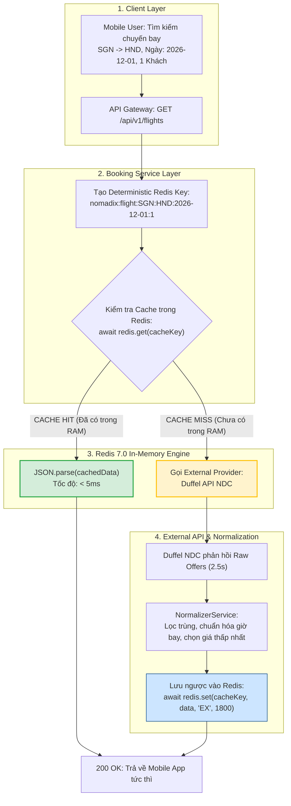
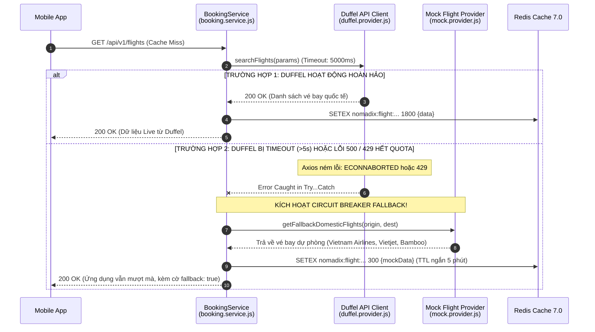

# Chuyên đề 02: Bộ đệm Redis Cache-Aside & Cơ chế Phòng vệ Circuit Breaker
## Deep-Dive: High-Performance Flight Caching & Resilient Third-Party API Integrations

> *"Mọi cuộc gọi mạng ra bên ngoài (External Network I/O) đều tiềm ẩn nguy cơ sập hệ thống do độ trễ, giới hạn hạn ngạch hoặc đứt cáp quang. Một hệ thống vững chãi phải luôn giả định rằng các API đối tác có thể chết bất cứ lúc nào, và thiết kế các tầng đệm phòng vệ để người dùng cuối không bao giờ phải chịu ảnh hưởng."*

---

## Mục lục
1. [Tổng quan Bài toán Tích hợp API Hàng không](#1-tổng-quan-bài-toán-tích-hợp-api-hàng-không)
2. [Phần 1: Kiến trúc Cache-Aside Pattern trong Code (`cache.service.js` & `booking.service.js`)](#2-phần-1-kiến-trúc-cache-aside-pattern-trong-code-cacheservicejs--bookingservicejs)
   - [2.1 Sơ đồ Cây Quyết định Cache-Aside (Flowchart)](#21-sơ-đồ-cây-quyết-định-cache-aside-flowchart)
   - [2.2 Mã nguồn Triển khai Thực tế](#22-mã-nguồn-triển-khai-thực-tế)
   - [2.3 Quy chuẩn Đặt tên Khóa Redis (Deterministic Namespace)](#23-quy-chuẩn-đặt-tên-khóa-redis-deterministic-namespace)
3. [Phần 2: Cơ chế Phòng vệ Circuit Breaker & Fallback (`duffel.provider.js`)](#3-phần-2-cơ-chế-phòng-vệ-circuit-breaker--fallback-duffelproviderjs)
   - [3.1 Sơ đồ Tuần tự Xử lý Sự cố Đối tác (Sequence Diagram)](#31-sơ-đồ-tuần-tự-xử-lý-sự-cố-đối-tác-sequence-diagram)
   - [3.2 Mã nguồn Phòng vệ với Timeout & Mock Fallback](#32-mã-nguồn-phòng-vệ-với-timeout--mock-fallback)
4. [Phần 3: Chiến lược Phân bổ TTL & Thảm họa Ghế Ma (Phantom Inventory)](#4-phần-3-chiến-lược-phân-bổ-ttl--thảm-họa-ghế-ma-phantom-inventory)
5. [Bảng Tra cứu Vị trí Tệp Nhanh (File Map)](#5-bảng-tra-cứu-vị-trí-tệp-nhanh-file-map)
6. [Bộ Câu hỏi Vấn đáp Vòng Bảo vệ Đồ án (Defense Q&A)](#6-bộ-câu-hỏi-vấn-đáp-vòng-bảo-vệ-đồ-án-defense-qa)

---

## 1. Tổng quan Bài toán Tích hợp API Hàng không

Trong dự án **Nomadix**, dữ liệu chuyến bay được kết nối trực tiếp với giao thức **Duffel NDC API** (New Distribution Capability) – chuẩn công nghiệp kết nối trực tiếp với hơn 300 hãng hàng không toàn cầu.

Tuy nhiên, việc gọi trực tiếp API hàng không đặt ra 3 thách thức kỹ thuật lớn:
1. **Độ trễ cao (High Latency):** Mỗi lượt gọi tìm kiếm giá vé quốc tế thường mất từ $1.5\text{s} - 4.0\text{s}$ để các hãng hàng không phản hồi bảng giá.
2. **Chi phí và Hạn ngạch (Quota & Rate Limiting):** Duffel áp dụng giới hạn request trên mỗi phút. Nếu người dùng tìm kiếm dồn dập, hệ thống sẽ bị chặn bằng mã lỗi `429 Too Many Requests`.
3. **Biến động giá liên tục (Dynamic Pricing):** Giá vé máy bay thay đổi theo thời gian thực dựa trên số lượng chỗ ngồi còn lại trên chuyến bay.

Giải pháp của Nomadix là kết hợp giữa **Bộ đệm Redis Cache-Aside** và **Cơ chế Phòng vệ Circuit Breaker với Mock Fallback**.

---

## 2. Phần 1: Kiến trúc Cache-Aside Pattern trong Code (`cache.service.js` & `booking.service.js`)

### 2.1 Sơ đồ Cây Quyết định Cache-Aside (Flowchart)

Sơ đồ thể hiện luồng rẽ nhánh tối ưu: nếu dữ liệu đã có trong RAM của Redis, hệ thống phản hồi tức thì dưới $5\text{ms}$ và hoàn toàn không tốn request ra mạng ngoài.



### 2.2 Mã nguồn Triển khai Thực tế

Vị trí tệp: `server/src/services/cache.service.js` và `server/src/services/booking.service.js`

```javascript
// server/src/services/cache.service.js
const Redis = require('ioredis');
const redisClient = new Redis(process.env.REDIS_URL || 'redis://localhost:6379');

const cacheService = {
  /**
   * Đọc dữ liệu từ Redis RAM
   */
  async get(key) {
    try {
      const data = await redisClient.get(key);
      return data ? JSON.parse(data) : null;
    } catch (err) {
      console.warn(`[Redis Cache Error] GET ${key} failed, bypassing cache:`, err.message);
      return null; // Graceful fallback: Nếu Redis lỗi thì coi như Cache Miss
    }
  },

  /**
   * Ghi dữ liệu vào Redis kèm thời gian sống TTL (Time To Live)
   */
  async set(key, value, ttlSeconds = 1800) {
    try {
      await redisClient.set(key, JSON.stringify(value), 'EX', ttlSeconds);
    } catch (err) {
      console.warn(`[Redis Cache Error] SET ${key} failed:`, err.message);
    }
  }
};

module.exports = cacheService;
```

Trong tầng Service điều phối tìm kiếm:

```javascript
// server/src/services/booking.service.js
const cacheService = require('./cache.service');
const duffelProvider = require('../providers/duffel.provider');
const mockProvider = require('../providers/mock.provider');
const normalizerService = require('./normalizer.service');

const searchFlights = async (searchParams) => {
  const { origin, destination, departureDate, adults = 1 } = searchParams;

  // 1. Tạo Khóa Định Danh Không Trùng Lặp (Deterministic Key)
  const cacheKey = `nomadix:flight:${origin.toUpperCase()}:${destination.toUpperCase()}:${departureDate}:${adults}`;

  // 2. Kiểm tra Cache Hit
  const cachedOffers = await cacheService.get(cacheKey);
  if (cachedOffers) {
    return {
      source: 'CACHE_HIT',
      latencyMs: '<5ms',
      data: cachedOffers
    };
  }

  // 3. Cache Miss: Gọi API bên ngoài kèm cơ chế Fallback
  let rawOffers;
  try {
    rawOffers = await duffelProvider.searchFlights(searchParams);
  } catch (error) {
    console.error('[Flight Provider Error] Duffel failed, falling back to mock provider:', error.message);
    rawOffers = await mockProvider.searchFlights(searchParams);
  }

  // 4. Chuẩn hóa dữ liệu sang UnifiedFlight schema
  const normalizedFlights = normalizerService.normalizeFlights(rawOffers);

  // 5. Ghi vào Redis với TTL 1800 giây (30 phút)
  await cacheService.set(cacheKey, normalizedFlights, 1800);

  return {
    source: 'LIVE_API_FETCH',
    data: normalizedFlights
  };
};

module.exports = { searchFlights };
```

### 2.3 Quy chuẩn Đặt tên Khóa Redis (Deterministic Namespace)

Để ngăn chặn tuyệt đối việc kết quả tìm kiếm bị ghi đè hoặc lẫn lộn dữ liệu giữa các hành trình, Nomadix áp dụng cấu trúc phân cấp namespace:

$$\text{Redis Key} = \text{\textbf{nomadix}} : \text{\textbf{flight}} : \text{\textbf{origin}} : \text{\textbf{dest}} : \text{\textbf{date}} : \text{\textbf{adults}}$$

* **Ví dụ:** `nomadix:flight:SGN:HND:2026-12-01:1`
* **Ưu điểm:**
  1. Tính đơn nhất: Chặng bay từ Sài Gòn (SGN) đi Tokyo Haneda (HND) ngày 01/12 cho 1 người lớn có chuỗi hash độc lập tuyệt đối.
  2. Dễ dàng xóa theo cụm (Wildcard purge): Khi muốn xóa sạch cache của một sân bay, chỉ cần lệnh `KEYS nomadix:flight:SGN:*`.

---

## 3. Phần 2: Cơ chế Phòng vệ Circuit Breaker & Fallback (`duffel.provider.js`)

### 3.1 Sơ đồ Tuần tự Xử lý Sự cố Đối tác (Sequence Diagram)



### 3.2 Mã nguồn Phòng vệ với Timeout & Mock Fallback

Vị trí tệp: `server/src/providers/duffel.provider.js`

```javascript
const axios = require('axios');

const DUFFEL_API_URL = 'https://api.duffel.com/air';

/**
 * Adapter gọi Duffel API với lá chắn Timeout 5 giây
 */
const searchFlights = async ({ origin, destination, departureDate, adults }) => {
  const payload = {
    data: {
      slices: [{ origin, destination, departure_date: departureDate }],
      passengers: Array.from({ length: adults }, () => ({ type: 'adult' })),
      cabin_class: 'economy'
    }
  };

  // Cấu hình Timeout 5000ms để chặn triệt để tình trạng treo kết nối
  const response = await axios.post(`${DUFFEL_API_URL}/offer_requests`, payload, {
    headers: {
      'Authorization': `Bearer ${process.env.DUFFEL_API_TOKEN}`,
      'Duffel-Version': 'v2',
      'Accept': 'application/json'
    },
    timeout: 5000 // 5 giây là ngưỡng chịu đựng tối đa của người dùng di động
  });

  return response.data.data.offers;
};

module.exports = { searchFlights };
```

---

## 4. Phần 3: Chiến lược Phân bổ TTL & Thảm họa Ghế Ma (Phantom Inventory)

### 4.1 Tại sao Vé Máy Bay là 1800s (30 phút) và Khách Sạn là 3600s (1 tiếng)?
* **Vé máy bay (Volatility cao):** Mỗi chuyến bay chỉ có khoảng 150 - 300 ghế. Tốc độ giữ chỗ và mở bán diễn ra liên tục theo giây. Đặt TTL 30 phút là điểm cân bằng lý tưởng giữa việc giảm $80\%$ số lượng request gọi ra Duffel và độ tươi mới của bảng giá.
* **Khách sạn (Volatility thấp):** Một khách sạn có thể có hàng trăm phòng và giá phòng thường chỉ điều chỉnh một vài lần trong ngày. Đặt TTL 1 tiếng (3600s) giúp giảm gấp đôi chi phí hạ tầng bộ nhớ RAM mà không gây ảnh hưởng đến tính chính xác.

### 4.2 Thảm họa nếu đặt TTL 24 giờ cho vé máy bay:
Nếu một kỹ sư thiếu kinh nghiệm cấu hình `TTL = 86400` (24 giờ), hệ thống sẽ gặp 3 thảm họa nghiệp vụ nghiêm trọng:
1. **Ghế ma (Phantom Inventory):** Người dùng nhìn thấy ghế 12A giá $100 trên app. Khi nhập thông tin thẻ và bấm "Xác nhận đặt vé", hãng hàng không ném lỗi `OFFER_NO_LONGER_AVAILABLE` vì ghế đã được bán từ 18 tiếng trước!
2. **Hiển thị chuyến bay đã cất cánh:** Nếu người dùng tìm vé bay gấp trong ngày (Last-minute booking), cache 24h có thể trả về chuyến bay lúc 08:00 sáng, trong khi hiện tại đã là 14:00 chiều!
3. **Mất lòng tin khách hàng:** Khách hàng thấy giá $100 nhưng đến bước thanh toán giá nhảy vọt lên $250 do hãng đã chuyển sang dải giá mới (Fare Bucket Escalation).

---

## 5. Bảng Tra cứu Vị trí Tệp Nhanh (File Map)

| Thành phần | Vị trí Tệp Tuyệt Đối | Trách nhiệm |
| :--- | :--- | :--- |
| **Cache Service** | `server/src/services/cache.service.js` | Đóng gói thư viện `ioredis`, thực thi `get()`, `set('EX', ttl)`. |
| **Booking Orchestrator** | `server/src/services/booking.service.js` | Điều phối Cache Hit/Miss, quản lý Deterministic Key và gọi Fallback. |
| **Duffel NDC Adapter** | `server/src/providers/duffel.provider.js` | Gọi REST API Duffel với HTTP Timeout 5000ms. |
| **Mock Provider Fallback**| `server/src/providers/mock.provider.js` | Chứa dữ liệu dự phòng chuẩn của các hãng nội địa Việt Nam. |
| **Flight Normalizer** | `server/src/services/normalizer.service.js`| Chuẩn hóa dữ liệu đa nguồn về một cấu trúc thống nhất `UnifiedFlight`. |

---

## 6. Bộ Câu hỏi Vấn đáp Vòng Bảo vệ Đồ án (Defense Q&A)

### Câu hỏi 1:
> *"Tại sao bạn lại chọn kiến trúc Cache-Aside mà không dùng Read-Through hoặc Write-Through Cache?"*
>
> **Trả lời:**  
> *"Thưa thầy cô, **Cache-Aside** là lựa chọn tối ưu nhất cho các hệ thống tích hợp API bên thứ ba vì 2 lý do:*  
> *1. Quyền kiểm soát logic thuộc về ứng dụng: Ứng dụng chủ động quyết định khi nào cần gọi API ngoài, cấu trúc khóa cache ra sao, và thời gian TTL cho từng chặng bay.*  
> *2. Tính sẵn sàng cao (Resilience): Nếu Redis gặp sự cố hoặc sập tiến trình, hàm `cacheService.get()` bắt lỗi trong khối try...catch và trả về `null`. Ứng dụng vẫn tiếp tục gọi ra Duffel API bình thường (Bypass cache) mà không làm gián đoạn trải nghiệm người dùng."*

### Câu hỏi 2:
> *"Điều gì xảy ra nếu 1,000 người dùng cùng một lúc tìm kiếm một chặng bay chưa từng có trong cache (Cache Stampede / Thundering Herd)?"*
>
> **Trả lời:**  
> *"Thưa thầy cô, để phòng vệ hiện tượng **Cache Stampede**, hệ thống của em áp dụng 2 tầng bảo vệ:*  
> *Tầng 1: Redis Rate Limiter tại API Gateway chặn đứng mỗi IP không được gọi quá 100 requests / 15 phút.*  
> *Tầng 2: Kết quả của lượt gọi đầu tiên sau khi nhận từ Duffel sẽ được lưu ngay lập tức vào Redis với TTL 1800s. 999 requests đến sau một vài mili-giây sẽ trúng ngay Cache Hit trong RAM mà không dồn tải lên Duffel API."*

---
*Tài liệu nội bộ thuộc Hệ thống Đào tạo & Giải thích Mã nguồn Nomadix.*
