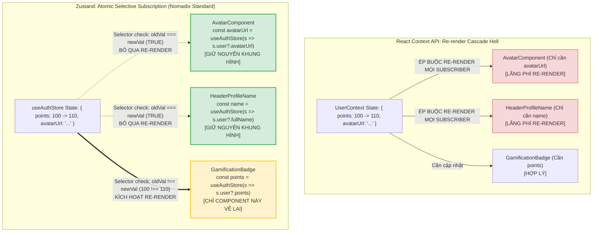
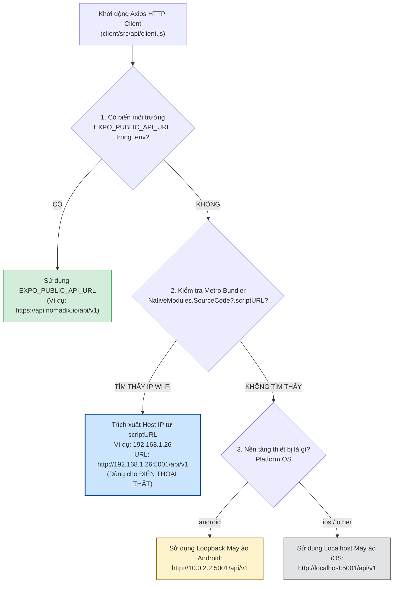

# Chuyên đề 03: Quản trị State với Zustand & Phân giải Mạng Động trong React Native
## Deep-Dive: Selective Subscription, 60 FPS Re-render Optimization & Dynamic LAN Networking

> *"Hiệu năng trên thiết bị di động không phụ thuộc vào việc điện thoại mạnh đến đâu, mà phụ thuộc vào việc mã nguồn của bạn có biết 'lười biếng' một cách thông minh hay không. Đừng bao giờ bắt CPU vẽ lại một màn hình khi dữ liệu thực sự cần hiển thị không hề suy xuyển."*

---

## Mục lục
1. [Tổng quan Bài toán Hiệu năng & Môi trường Di động](#1-tổng-quan-bài-toán-hiệu-năng--môi-trường-di-động)
2. [Phần 1: Tư duy Lựa chọn State Management (Zustand vs Redux vs Context API)](#2-phần-1-tư-duy-lựa-chọn-state-management-zustand-vs-redux-vs-context-api)
   - [2.1 Sơ đồ So sánh Lan truyền Re-render (Context vs Zustand)](#21-sơ-đồ-so-sánh-lan-truyền-re-render-context-vs-zustand)
   - [2.2 Cấu trúc 6 Domain Stores Độc lập trong Nomadix](#22-cấu-trúc-6-domain-stores-độc-lập-trong-nomadix)
3. [Phần 2: Kỹ thuật Selector Chống Re-render Thừa Thãi (Duy trì 60 FPS)](#3-phần-2-kỹ-thuật-selector-chống-re-render-thừa-thãi-duy-trì-60-fps)
   - [3.1 Phân tích Mã nguồn Gây Tụt Khung hình vs Mã nguồn Chuẩn](#31-phân-tích-mã-nguồn-gây-tụt-khung-hình-vs-mã-nguồn-chuẩn)
   - [3.2 Kỹ thuật `useShallow` khi cần bóc tách nhiều trường](#32-kỹ-thuật-useshallow-khi-cần-bóc-tách-nhiều-trường)
4. [Phần 3: Tự động Phân giải Địa chỉ Mạng Động (`client/src/api/client.js`)](#4-phần-3-tự-động-phân-giải-địa-chỉ-mạng-động-clientsrcapiclientjs)
   - [3.1 Sơ đồ Cây Quyết định Phân giải Địa chỉ IP](#31-sơ-đồ-cây-quyết-định-phân-giải-địa-chỉ-ip)
   - [3.2 Mã nguồn `resolveApiBaseUrl` Bắt sóng Metro Bundler](#32-mã-nguồn-resolveapibaseurl-bắt-sóng-metro-bundler)
5. [Bảng Tra cứu Vị trí Tệp Nhanh (File Map)](#5-bảng-tra-cứu-vị-trí-tệp-nhanh-file-map)
6. [Bộ Câu hỏi Vấn đáp Vòng Bảo vệ Đồ án (Defense Q&A)](#6-bộ-câu-hỏi-vấn-đáp-vòng-bảo-vệ-đồ-án-defense-qa)

---

## 1. Tổng quan Bài toán Hiệu năng & Môi trường Di động

Phát triển ứng dụng di động với **React Native / Expo** đặt ra 2 thách thức kỹ thuật lớn hơn rất nhiều so với ứng dụng Web:
1. **Rào cản Phần cứng (Resource-constrained Devices):** Thiết bị di động chạy trên vi xử lý ARM, pin có hạn và màn hình quét ở tần số $60\text{Hz}$ (mỗi khung hình chỉ có $16.6\text{ms}$ để hoàn tất tính toán và vẽ lại). Việc re-render mất kiểm soát sẽ dẫn đến hiện tượng tụt FPS (Drop frames), đơ giao diện và nóng máy.
2. **Sự không đồng nhất của Môi trường Mạng (Network Heterogeneity):** Lập trình viên chạy code trên cả **iOS Simulator**, **Android Emulator**, và **Điện thoại thật (Physical Device qua Wi-Fi)**. Khái niệm `localhost` hoạt động hoàn toàn khác nhau trên từng môi trường này.

---

## 2. Phần 1: Tư duy Lựa chọn State Management (Zustand vs Redux vs Context API)

### 2.1 Sơ đồ So sánh Lan truyền Re-render (Context vs Zustand)

Sơ đồ thể hiện rõ tại sao **React Context API** gây ra thảm họa "Re-render Cascade", trong khi **Zustand** cô lập biến động và chỉ cập nhật đúng component thực sự cần.



### 2.2 Cấu trúc 6 Domain Stores Độc lập trong Nomadix

Thay vì gộp một store khổng lồ như Redux monolith, Nomadix module hóa thành 6 stores hướng tên miền (Domain-Driven):
1. [`client/src/stores/auth.store.js`](file:///Users/3o/Documents/Study/Project_gra/FYP/client/src/stores/auth.store.js): Quản lý phiên làm việc, Access/Refresh token, Google Profile.
2. [`client/src/stores/booking.store.js`](file:///Users/3o/Documents/Study/Project_gra/FYP/client/src/stores/booking.store.js): Quản lý tìm kiếm vé bay, lọc theo hãng, giỏ phòng khách sạn.
3. [`client/src/stores/itinerary.store.js`](file:///Users/3o/Documents/Study/Project_gra/FYP/client/src/stores/itinerary.store.js): Lưu trữ danh sách kế hoạch du lịch, stops theo ngày, squad sync.
4. [`client/src/stores/expense.store.js`](file:///Users/3o/Documents/Study/Project_gra/FYP/client/src/stores/expense.store.js): Sổ nợ chi tiêu, bảng cân đối ròng, kế hoạch giải quyết nợ dứt điểm.
5. [`client/src/stores/places.store.js`](file:///Users/3o/Documents/Study/Project_gra/FYP/client/src/stores/places.store.js): Bộ đệm địa danh du lịch từ OpenTripMap, wishlist yêu thích.
6. [`client/src/stores/theme.store.js`](file:///Users/3o/Documents/Study/Project_gra/FYP/client/src/stores/theme.store.js): Điều hướng màu sắc tương phản cao giữa Light `#F8FAFC` và Obsidian Dark `#121316`.

---

## 3. Phần 2: Kỹ thuật Selector Chống Re-render Thừa Thãi (Duy trì 60 FPS)

### 3.1 Phân tích Mã nguồn Gây Tụt Khung hình vs Mã nguồn Chuẩn

#### ❌ Mã nguồn kém (Bad Practice):
```javascript
// Trích xuất cả object user từ useAuthStore
const { user } = useAuthStore();

return <Image source={{ uri: user?.avatarUrl }} style={styles.avatar} />;
```
* **Lỗ hổng:** Trong JavaScript, mỗi khi gọi `set({ user: { ...user, points: 110 } })`, một đối tượng mới được tạo ra ở một địa chỉ ô nhớ khác (New Reference). Phép so sánh nông của React hook thấy tham chiếu `user` thay đổi $\rightarrow$ cưỡng bức component vẽ lại toàn bộ cây DOM ảo!

#### ✅ Mã nguồn chuẩn kỹ sư Nomadix (Atomic Selector):
```javascript
// Chỉ đăng ký theo dõi đúng giá trị nguyên thủy (Primitive String)
const avatarUrl = useAuthStore((state) => state.user?.avatarUrl);

return <Image source={{ uri: avatarUrl }} style={styles.avatar} />;
```
* **Bản chất kỹ thuật ngầm:**  
  Zustand chạy hàm selector sau mỗi lần state thay đổi và kiểm tra:
  $$\text{previousValue} === \text{nextValue}$$
  Vì `"https://...avatar.jpg" === "https://...avatar.jpg"` luôn trả về `true`, Zustand triệt tiêu hoàn toàn sự kiện render của component này.

### 3.2 Kỹ thuật `useShallow` khi cần bóc tách nhiều trường

Khi một component thực sự cần lắng nghe từ 2 trường dữ liệu trở lên, việc trả về một Object mới `{ fullName, email }` sẽ tạo ra tham chiếu mới. Ta sử dụng `useShallow`:

```javascript
import { useShallow } from 'zustand/react/shallow';

const { fullName, email } = useAuthStore(
  useShallow((state) => ({
    fullName: state.user?.fullName,
    email: state.user?.email
  }))
);
```
`useShallow` sẽ so sánh từng key bên trong object trả về. Nếu cả `fullName` và `email` đều không đổi, nó sẽ giữ nguyên tham chiếu cũ và ngăn chặn re-render.

---

## 4. Phần 3: Tự động Phân giải Địa chỉ Mạng Động (`client/src/api/client.js`)

### 4.1 Sơ đồ Cây Quyết định Phân giải Địa chỉ IP

Sơ đồ minh họa đường đi của logic `resolveApiBaseUrl` tự động nhận diện thiết bị mà không cần sửa code thủ công:



### 4.2 Mã nguồn `resolveApiBaseUrl` Bắt sóng Metro Bundler

Vị trí tệp: [`client/src/api/client.js`](file:///Users/3o/Documents/Study/Project_gra/FYP/client/src/api/client.js)

```javascript
import axios from 'axios';
import { Platform, NativeModules } from 'react-native';

/**
 * Tự động phân giải địa chỉ Base URL cho API
 * Đảm bảo kết nối thông suốt trên mọi loại thiết bị (Máy ảo / Máy thật)
 */
const resolveApiBaseUrl = () => {
  // 1. Nếu có biến môi trường tường minh từ file .env
  if (process.env.EXPO_PUBLIC_API_URL) {
    return process.env.EXPO_PUBLIC_API_URL;
  }

  // 2. Kỹ thuật Bắt sóng Metro: Trích xuất IP máy chủ phát mã nguồn
  // scriptURL có dạng: "http://192.168.1.26:8081/index.bundle?platform=android..."
  const scriptURL = NativeModules.SourceCode?.scriptURL;
  if (scriptURL) {
    const address = scriptURL.split('://')[1]?.split('/')[0];
    const hostIp = address?.split(':')[0];
    // Loại trừ localhost để không nhầm lẫn khi chạy trên simulator
    if (hostIp && hostIp !== 'localhost' && hostIp !== '127.0.0.1') {
      return `http://${hostIp}:5001/api/v1`;
    }
  }

  // 3. Quy chuẩn máy ảo Android (Android Emulator nối với máy tính chủ qua 10.0.2.2)
  if (Platform.OS === 'android') {
    return 'http://10.0.2.2:5001/api/v1';
  }

  // 4. Quy chuẩn máy ảo iOS (chia sẻ chung card mạng loopback với máy Mac)
  return 'http://localhost:5001/api/v1';
};

const apiClient = axios.create({
  baseURL: resolveApiBaseUrl(),
  timeout: 10000,
  headers: {
    'Content-Type': 'application/json'
  }
});

export default apiClient;
```

---

## 5. Bảng Tra cứu Vị trí Tệp Nhanh (File Map)

| Thành phần | Vị trí Tệp Tuyệt Đối | Trách nhiệm |
| :--- | :--- | :--- |
| **Network Client** | `client/src/api/client.js` | Tự động phân giải `baseURL`, tiêm Bearer JWT vào Header. |
| **Auth Store** | `client/src/stores/auth.store.js` | Quản lý đăng nhập, Google OAuth, lưu tokens vào `expo-secure-store`. |
| **Itinerary Store** | `client/src/stores/itinerary.store.js` | Quản lý lộ trình đa ngày, danh sách chuyến đi, điều hướng Plan Hub. |
| **Expense Store** | `client/src/stores/expense.store.js` | Quản lý hóa đơn nhóm, tính toán nợ tham lam $O(N \log N)$. |
| **Profile Screen** | `client/src/screens/account/ProfileScreen.js` | Ứng dụng Atomic Selector để render avatar và badges không gây giật lag. |

---

## 6. Bộ Câu hỏi Vấn đáp Vòng Bảo vệ Đồ án (Defense Q&A)

### Câu hỏi 1:
> *"Tại sao bạn lại lưu Access Token và Refresh Token trong `expo-secure-store` mà không dùng `AsyncStorage` thông thường?"*
>
> **Trả lời:**  
> *"Thưa thầy cô, `AsyncStorage` chỉ lưu trữ dữ liệu dưới dạng plain-text không mã hóa trên bộ nhớ thiết bị. Nếu điện thoại bị can thiệp (Root trên Android hoặc Jailbreak trên iOS), kẻ tấn công có thể dễ dàng trích xuất file database SQLite của app để đánh cắp Refresh Token.  
> Ngược lại, **`expo-secure-store`** mã hóa dữ liệu ở cấp độ phần cứng bằng **Keychain trên iOS** và **Android Keystore / EncryptedSharedPreferences trên Android**, đảm bảo các khóa giải mã không bao giờ bị lộ ra ngoài."*

### Câu hỏi 2:
> *"Tại sao máy ảo Android bắt buộc phải dùng IP `10.0.2.2` thay vì `localhost`?"*
>
> **Trả lời:**  
> *"Thưa thầy cô, máy ảo Android Emulator chạy như một máy ảo độc lập bên trong hệ điều hành máy tính (QEMU/KVM). Địa chỉ `localhost` (127.0.0.1) trên Android Emulator trỏ vào chính vòng lặp nội bộ của máy ảo Android chứ không phải máy tính phát triển. Nhà phát triển Android quy định router ảo của máy ảo sử dụng địa chỉ đặc biệt **`10.0.2.2`** làm cầu nối Alias trỏ ngược về loopback interface của máy tính chủ đang chạy Express Backend."*

---
*Tài liệu nội bộ thuộc Hệ thống Đào tạo & Giải thích Mã nguồn Nomadix.*
