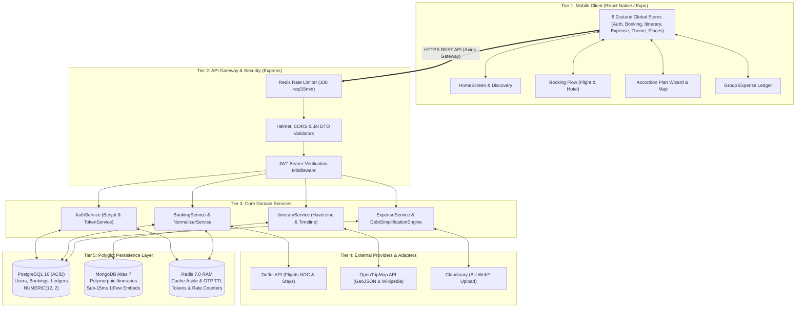
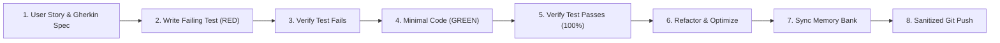
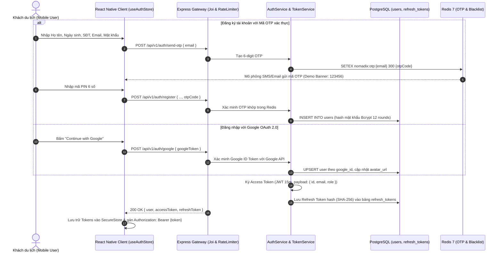
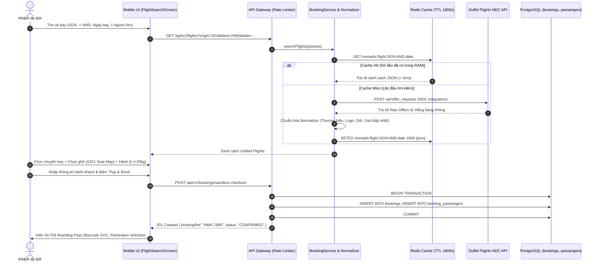
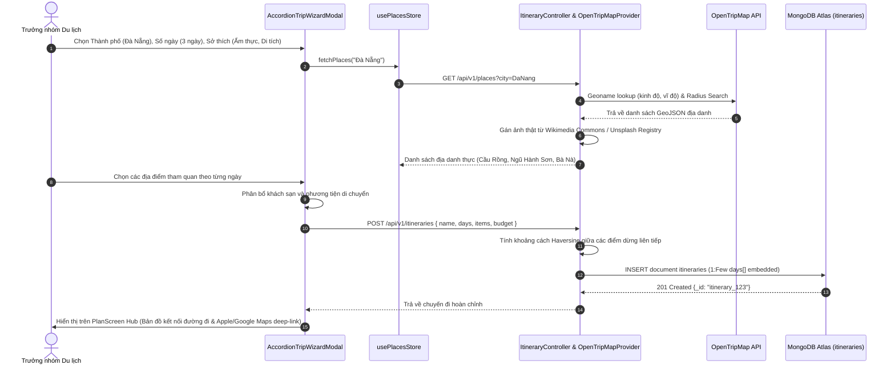
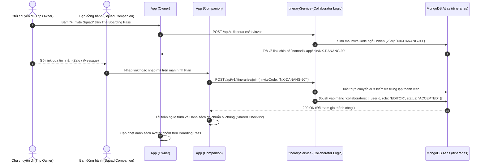
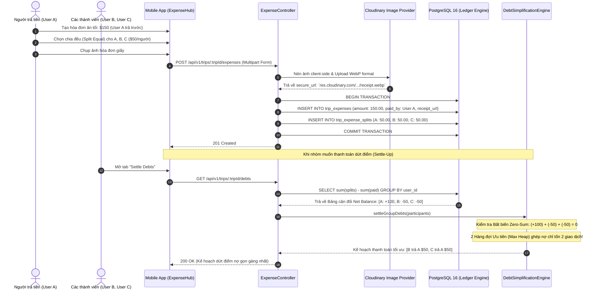

# Cẩm nang Toàn diện Workflow Hệ thống & Quy trình Kỹ thuật Nomadix
## Master End-to-End Project Workflow Blueprint

> *"Architecture is the decisions that you wish you could get right the first time. But a Workflow is the living heartbeat of your system — showing how data, code, state, and human interactions seamlessly travel across tiers to create value."*

---

## Mục lục
1. [Tổng quan Luồng Hệ thống (High-Level System Signal-Flow)](#1-tổng-quan-luồng-hệ-thống-high-level-system-signal-flow)
2. [Workflow 1: Vòng đời Kỹ thuật Phần mềm (Engineering & Development Workflow)](#2-workflow-1-vòng-đời-kỹ-thuật-phần-mềm-engineering--development-workflow)
3. [Workflow 2: Định danh & Phiên làm việc (Identity, Authentication & Session Lifecycle)](#3-workflow-2-định-danh--phiên-làm-việc-identity-authentication--session-lifecycle)
4. [Workflow 3: Đặt vé Thông minh & Cache-Aside (Smart Booking & Cache-Aside Pipeline)](#4-workflow-3-đặt-vé-thông-minh--cache-aside-smart-booking--cache-aside-pipeline)
5. [Workflow 4: Lập kế hoạch Du lịch Đa thành phố & Bản đồ (Multi-City Planning & Map Route Discovery)](#5-workflow-4-lập-kế-hoạch-du-lịch-đa-thành-phố--bản-đồ-multi-city-planning--map-route-discovery)
6. [Workflow 5: Đồng hành & Đồng bộ Nhóm Thời gian Thực (Squad Collaboration & Real-Time Sync)](#6-workflow-5-đồng-hành--đồng-bộ-nhóm-thời-gian-thực-squad-collaboration--real-time-sync)
7. [Workflow 6: Phân bổ Chi phí & Giải quyết Công nợ Nhóm (Group Expense Splitting & Debt Settlement Pipeline)](#7-workflow-6-phân-bổ-chi-phí--giải-quyết-công-nợ-nhóm-group-expense-splitting--debt-settlement-pipeline)
8. [Workflow 7: Điều phối Nhất quán Đa Cơ sở Dữ liệu (Polyglot Cross-Database Consistency)](#8-workflow-7-điều-phối-nhất-quán-đa-cơ-sở-dữ-liệu-polyglot-cross-database-consistency)

---

## 1. Tổng quan Luồng Hệ thống (High-Level System Signal-Flow)

Hệ thống **Nomadix** là một nền tảng du lịch kết hợp lập kế hoạch đồng đội, tích hợp sâu giữa ứng dụng di động React Native, API Gateway Express, các nhà cung cấp dịch vụ bên ngoài (Duffel, OpenTripMap, Cloudinary) và kiến trúc lưu trữ đa mô hình (**Polyglot Persistence: PostgreSQL + MongoDB + Redis**).

Dưới đây là sơ đồ luồng tín hiệu tổng thể thể hiện cách các thành phần tương tác:



---

## 2. Workflow 1: Vòng đời Kỹ thuật Phần mềm (Engineering & Development Workflow)

Để bảo đảm một hệ sinh thái lớn (222 test suites, hơn 846 tests) không bao giờ bị gãy hay sinh lỗi hồi quy (regression bugs), kỹ sư Nomadix tuân thủ nghiêm ngặt quy trình **Solo Extreme Programming (XP) & Test-Driven Development (TDD)**:



### Các bước trong chu trình:
1. **Phân tích BDD / Gherkin:** Xác định hành vi nghiệp vụ kỳ vọng trước khi gõ code.
2. **Pha RED:** Viết test suite mô tả hành vi mong muốn (Unit test hoặc Component test). Chạy test và chứng minh test **thất bại** vì tính năng chưa tồn tại.
3. **Pha GREEN:** Viết số lượng code tối thiểu để bài test chuyển sang màu xanh.
4. **Pha REFACTOR:** Làm sạch code, loại bỏ duplicate, tối ưu thuật toán mà vẫn đảm bảo 100% test suites vượt qua.
5. **Cập nhật Memory Bank:** Đồng bộ hóa tự động tiến độ vào `memory-bank/activeContext.md` và `memory-bank/progress.md`.
6. **Kiểm tra Toàn vẹn & Phát hành (Delivery):** Chạy script Python loại bỏ mã nháp, file nội bộ và push lên kho lưu trữ chính thức.

---

## 3. Workflow 2: Định danh & Phiên làm việc (Identity, Authentication & Session Lifecycle)

Quy trình xác thực trong Nomadix được bảo vệ bằng mô hình đa lớp: **Bcrypt (12 rounds) + Dual JWT (Access Token 15 phút + Refresh Token lưu tại cơ sở dữ liệu)** cùng cơ chế lưu trữ an toàn trên thiết bị di động (`expo-secure-store`).



---

## 4. Workflow 3: Đặt vé Thông minh & Cache-Aside (Smart Booking & Cache-Aside Pipeline)

Luồng tìm kiếm chuyến bay và khách sạn xử lý hàng ngàn kết quả thông qua kiến trúc **Cache-Aside** trên Redis 7.0, kết hợp bộ chuẩn hóa dữ liệu đa nguồn (**Unified Normalizer**) và sinh thẻ **Boarding Pass** chuẩn hàng không.



---

## 5. Workflow 4: Lập kế hoạch Du lịch Đa thành phố & Bản đồ (Multi-City Planning & Map Route Discovery)

Lập kế hoạch du lịch là trái tim của Nomadix. Luồng công việc này chuyển hóa ý tưởng của người dùng thành một lộ trình hoàn chỉnh có tọa độ địa lý, ảnh phong cảnh thực tế và điều hướng GPS:



---

## 6. Workflow 5: Đồng hành & Đồng bộ Nhóm Thời gian Thực (Squad Collaboration & Real-Time Sync)

Đi du lịch theo nhóm đòi hỏi sự đồng thuận cao. Nomadix cung cấp quy trình mời bạn đồng hành bảo mật và phân quyền vai trò (Role-Based Access Control) ngay trong lịch trình:



---

## 7. Workflow 6: Phân bổ Chi phí & Giải quyết Công nợ Nhóm (Group Expense Splitting & Debt Settlement Pipeline)

Đây là quy trình phức tạp nhất về mặt kỹ thuật, kết hợp giữa **Lưu trữ Hóa đơn (Cloudinary)**, **Giao dịch Ngân hàng ACID (PostgreSQL)**, và **Thuật toán Tham lam Rút gọn Dòng tiền Tối thiểu (Greedy Minimum Cash-Flow Reduction $O(N \log N)$)**:



---

## 8. Workflow 7: Điều phối Nhất quán Đa Cơ sở Dữ liệu (Polyglot Cross-Database Consistency)

Trong kiến trúc Polyglot của Nomadix, không tồn tại khóa ngoại vật lý (Physical Foreign Key) giữa PostgreSQL và MongoDB Atlas. Hệ thống duy trì tính nhất quán bằng mô hình **Application-Layer Referential Integrity**:

```
┌──────────────────────────────────────┐          ┌──────────────────────────────────────┐
│       POSTGRESQL 16 (RELATIONAL)     │          │       MONGODB ATLAS 7 (DOCUMENT)     │
├──────────────────────────────────────┤          ├──────────────────────────────────────┤
│ TABLE: users                         │          │ COLLECTION: itineraries              │
│   id: UUID (Primary Key)             │◄───┐     │   _id: ObjectId / String (Primary)   │
│   email: VARCHAR                     │    │     │   title: String                      │
│   full_name: VARCHAR                 │    │     │   destination: String                │
├──────────────────────────────────────┤    │     │   collaborators: [                   │
│ TABLE: trip_expenses                 │    │     │     {                                │
│   id: UUID (Primary Key)             │    │     │       userId: String, ───────────────┘
│   trip_id: VARCHAR(50) (Indexed) ────┼────┼───► │       role: "OWNER" | "EDITOR"       │
│   paid_by: UUID (FK -> users.id)     │    │     │     }                                │
│   amount: NUMERIC(12, 2)             │    │     │   ]                                  │
├──────────────────────────────────────┤    │     │   days: [                            │
│ TABLE: trip_settlements              │    │     │     { items: [ ... ] }               │
│   trip_id: VARCHAR(50) (Indexed) ────┼────┘     │   ]                                  │
│   debtor_id: UUID (FK -> users.id)   │          └──────────────────────────────────────┘
│   creditor_id: UUID (FK -> users.id) │
└──────────────────────────────────────┘
```

### Nguyên tắc Vàng trong Điều phối:
1. **MongoDB lưu trữ Lịch trình & Phân quyền:**
   Mỗi chuyến đi được định danh bằng một chuỗi `tripId` duy nhất trong MongoDB. Các cộng tác viên được lưu dưới dạng mảng con `collaborators` chứa `userId` (chuỗi UUID tương ứng với bảng `users` trong PostgreSQL).
2. **PostgreSQL lưu trữ Sổ cái Tài chính:**
   Bảng `trip_expenses` và `trip_settlements` chỉ cần lưu cột chỉ mục `trip_id VARCHAR(50)`. Khi người dùng muốn xem sổ nợ của chuyến đi `X`, PostgreSQL chỉ cần truy vấn `WHERE trip_id = 'X'` với tốc độ $< 2\text{ms}$ nhờ B-Tree Index.
3. **Không xảy ra Distributed Deadlock:**
   Toàn bộ tiền bạc, nợ nần, thanh toán đều nằm trọn vẹn trong PostgreSQL ACID Engine. MongoDB không bao giờ tham gia vào tính toán tiền bạc, loại trừ hoàn toàn nguy cơ mất dữ liệu hay xung đột khóa phân tán.

---
*Tài liệu tham khảo thuộc Bộ Giáo trình Đào tạo Kỹ sư Nomadix Core Platform.*
